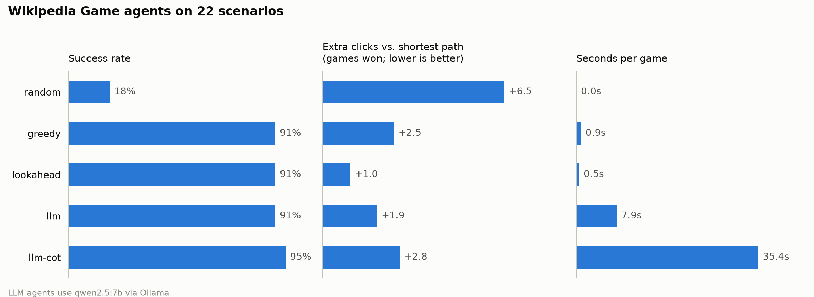

# wikirace-ai

Bots that play the [Wikipedia game](https://en.wikipedia.org/wiki/Wikipedia:Wiki_Game): start on one article and keep clicking links until you reach a target article. No search, no back button.

I wanted to see how far you can get with just sentence embeddings vs a local LLM, and how close any of them get to the actual shortest path.

## how it works

Each turn the bot gets the links on the current page and has to pick one. There are 5 agents:

- `random`: picks a random link (baseline)
- `greedy`: embeds the target and every link with SBERT (all-MiniLM-L6-v2) and clicks the most similar one
- `lookahead`: takes the top 5 links, opens each one and scores it by how close its own links get to the target (0.3 * own similarity + 0.7 * best next similarity)
- `llm`: embeddings pick the top 8 links, then a local LLM (qwen2.5:7b through Ollama) chooses one
- `llm-cot`: same thing but the model has to explain its reasoning first

Links get embedded as "Title: short description" (the description comes back in the same API call), which helps with things like Apple vs Apple Inc.

Rules: you can't visit a page twice, the target gets clicked automatically if it's on the page, and you lose after 20 clicks.

### shortest path

To score the bots I needed the real shortest path. BFS over all of Wikipedia is way too many requests, so `oracle.py` checks in order:

1. is the target linked from the start page
2. does any page on the start page link to the target (the API's `pltitles` filter checks 50 pages per request)
3. does any page two clicks away show up in the target's backlinks

1 and 2 are checked completely before 3, so if it finds a 3 click path that's guaranteed to be the shortest. If it finds nothing it just reports a lower bound.

## results

22 start/target pairs: 16 unrelated ones (Pizza -> Quantum mechanics, Honey bee -> Apollo 11, ...) and 6 homonym traps (Jaguar Cars -> Jaguar, Apple Inc. -> Apple, ...). Every agent plays every pair.



Things I noticed:

- lookahead was the most efficient, about 1 click over the shortest path on average, and it doesn't use the LLM at all
- the LLM is good at finding hub pages (Coffee -> Coffee in Italy -> Culture of Italy -> Leonardo da Vinci) but it can only pick from the 8 links the embeddings give it. On Jaguar Cars -> Jaguar all 8 were car models, so every agent got stuck
- chain of thought was about 4.5x slower per move and didn't make the paths shorter
- the descriptions fixed Apple Inc. -> Apple but broke a couple of other games, so overall it was a wash
- Banana -> Cold War and Java (programming language) -> Java turned out to be 1 click each, which is 2 of random's 4 wins

Raw numbers are in `results/`.

## setup

Needs Python 3.10+, and [Ollama](https://ollama.com) for the LLM agents.

```bash
git clone https://github.com/purva-kakade/wikirace-ai.git
cd wikirace-ai
python -m venv .venv && source .venv/bin/activate
pip install -e ".[dev]"
ollama pull qwen2.5:7b
```

Wikipedia only allows 10 requests/min from anonymous scripts, so put some contact info in the user agent to get 200/min:

```bash
export WIKIRACE_CONTACT="https://github.com/<your-username>"
```

## usage

```bash
wikirace play                                        # asks for start, target and agent
wikirace play "Pizza" "Albert Einstein" --chrome     # opens every click as a new tab in chrome
wikirace play "Pizza" "Albert Einstein" --agent llm-cot -v
wikirace shortest "Pizza" "Quantum mechanics"
wikirace bench                                       # full benchmark, writes to results/
```

Everything from Wikipedia gets cached in `.cache/wikipedia.sqlite`, so reruns are fast.

## tests

```bash
pytest
```

The tests run offline with a fake wiki graph, a bag of words embedder and a scripted LLM.

## todo

- diversify the shortlist so the LLM doesn't get 8 versions of the same thing
- use a Wikipedia dump for an exact BFS and a much bigger benchmark
- try other models
